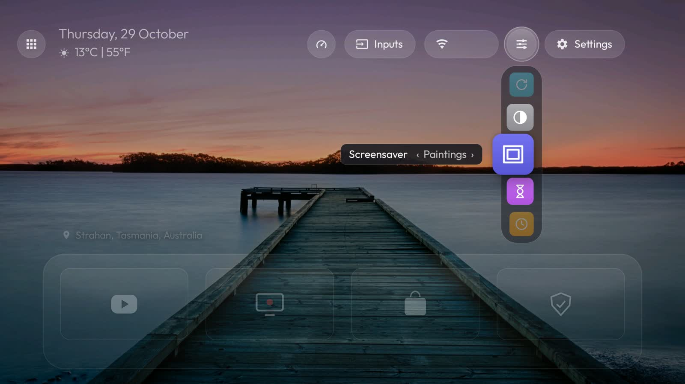

# Fire TV Glass: a calm, ad-free home for Fire TV Edition TVs

A clean home screen for Fire TV Edition TVs, a phone remote that needs no app, and an
art mode that turns the whole TV into a framed painting. Set up from a Mac over Wi-Fi.
No root, nothing uninstalled, everything reversible.


## What you get

- **Glass, the home screen.** Your four most recent apps, a "For you" row of popular films
  and shows (optional), the clock, the weather, and a new wallpaper every night at 12 AM.
  Everything else sits in an Apps dock on the left.
- **Customize, the iPhone way.** Every setting is an icon in a dock hanging from the Customize
  button. The focused one floats out with its name and its current choice.
- **Paintings.** As the screensaver, or on demand from Tools: the screen becomes a dark walnut
  frame with a gold edge and a painting inside it, drawn at the TV's full 4K. 15 clear,
  detailed public-domain works (Seurat, Hokusai, Church, Heade, Homer, Guardi and more), gently
  dimmed so they're easy on the eyes. They change on your schedule and drift very slowly,
  so nothing burns in.
- **Phone remote.** Open a QR code on your phone and pair it once with a 4-digit code. You get
  swipe to move, tap to select, typing, volume, your apps, Tools, Paintings, and Sleep, which
  turns the TV off and on. Any press wakes the TV. Same Wi-Fi only, and each phone pairs with
  one TV.
- **Less Amazon clutter.** An optional, reviewable list of Amazon system apps to switch off
  (`pm disable-user`, never uninstalled), plus optional ad and tracker blocking DNS.
- **Nightly upkeep** from the Mac: keeps everything as you set it, updates the open-source extras.



## Set it up

You need a Mac on the same Wi-Fi as the TV, and [Homebrew](https://brew.sh).

1. **On the TV:** Settings > My Fire TV > About, click the TV's name 7 times. Then
   Settings > My Fire TV > Developer Options, turn on **ADB debugging**. Note the TV's IP
   address (Settings > Network).
2. **On the Mac:** `brew install android-platform-tools`, download this project, and open a
   Terminal in its folder.
3. Run the steps one at a time. Each one shows what it did, and the ones marked STOP wait for you:

```sh
./setup.sh 192.168.1.50 check      # read-only: is this TV supported?
./setup.sh 192.168.1.50 protect    # records your own apps: these are never touched
./setup.sh 192.168.1.50 plan       # STOP: review tvs/<model>-<ip>/plan.txt, delete lines to keep
./setup.sh 192.168.1.50 debloat    # switch off what's left in the plan (reversible)
./setup.sh 192.168.1.50 home       # Glass, wallpapers, screensaver delay
./setup.sh 192.168.1.50 paintings  # optional: the Paintings art mode (~50 MB)
./setup.sh 192.168.1.50 extras     # optional, one by one: Aerial Views, Jellyfin, F-Droid, ...
./setup.sh 192.168.1.50 verify     # proof that Home works and your apps are all still there
```

Use your TV's address instead of `192.168.1.50`. Already set up and just want the newest
Glass? `./setup.sh <ip> update` keeps your wallpapers and settings.

**Changed your mind?** `./setup.sh <ip> undo` turns everything back on and gives Home back
to Amazon. Then `adb shell pm uninstall com.ivantrj.glasslauncher`.

[PLAYBOOK.md](PLAYBOOK.md) has the details: every stage, nightly upkeep, Siri and Shortcuts,
the "For you" row, and the Fire OS gotchas we hit along the way.

## Good to know

- **Tested on** two Fire TV Edition TVs (model AFTDCT31, Fire OS 7.7, one 65" 4K). Glass
  started as a launcher for the Fire TV Stick, but this kit has only been tested on TVs.
- **Your phone remote needs the Mac once after each TV restart.** Fire OS doesn't let apps
  press keys inside other apps, so a small helper does it, and only a computer can start that
  helper (setup and nightly upkeep do it). Without it the remote still works on the home
  screen and in simple apps.
- **Shared building Wi-Fi** often keeps devices apart. Then the phone remote and the Mac
  can't reach the TV.
- **Permissions Glass asks for, and why:** accessibility, so Home opens Glass rather than
  Amazon's launcher. Device admin, but only for "turn the screen off", so the remote's Sleep
  button works. Secure settings, only so Customize can switch screensavers. All are granted
  from the Mac during setup, and `undo` takes them back.

## Credits and licences

Glass is a fork of [ivantrj/firetv-glass-launcher](https://github.com/ivantrj/firetv-glass-launcher)
(MIT). This project is MIT too, see [LICENSE](LICENSE). The paintings, wallpapers, font and
libraries have their own licences, listed in [CREDITS.md](CREDITS.md).

Made by Shounak with Claude.
